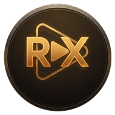

# RX Player Pro

<p align="center">
  
</p>

<p align="center">
  <strong>Next-Generation Precision Media Engine for Android</strong><br />
  <em>Hardware-Accelerated • 100% Offline-First • Zero Ads • Audiophile Sound Engine</em>
</p>

<p align="center">
  <a href="https://github.com/jcksprwx/RX-Player-Pro/releases/tag/v2.0.1"></a>
  <a href="https://github.com/jcksprwx/RX-Player-Pro/releases/download/v2.0.1/RX-Player-Pro-v2.0.1.apk"></a>
  
  
  
  <a href="LICENSE"></a>
</p>

---

## 📥 Downloads & Quick Links

- 🚀 **[Download Latest Production Release (v2.0.1 APK)](https://github.com/jcksprwx/RX-Player-Pro/releases/download/v2.0.1/RX-Player-Pro-v2.0.1.apk)** *(18.69 MB, SHA-256: `E101E8B81415A8EEA1408B2A217291892B1A5563B720122337AC36709415C0EE`)*
- 📦 **[View All GitHub Releases](https://github.com/jcksprwx/RX-Player-Pro/releases)**
- 📝 **[Full v2.0.1 Release Notes](https://github.com/jcksprwx/RX-Player-Pro/releases/tag/v2.0.1)**

---

## 🚀 What's New in Version 2.0.1

### 🛠️ Touch Gesture & Controls Fix
- **Touch Gestures Active with Controls Visible:** Fixed a bug where touch seek (horizontal drag), volume (right vertical swipe), and brightness (left vertical swipe) were disabled when player controls and the play button were shown on screen.
- **Top-Layer Gesture HUD:** Center HUD indicators (Volume %, Brightness %, Seek target & delta preview) are now elevated to the topmost layer over the controls, eliminating visual overlap.
- **Adaptive Center Controls Fade:** Center transport buttons (Play/Pause, Rewind, Fast-Forward, Prev, Next) smoothly fade out while actively dragging to give unobstructed prominence to the gesture HUD, and fade back in upon release.
- **Intelligent Child Pointer Routing:** Bottom seekbar scrubbing and individual button clicks remain isolated and highly responsive without false triggers or gesture conflict.
- **Gesture-Aware Controls Auto-Hide:** Gesturing for volume, brightness, or seeking actively keeps the interaction timer alive, preventing unexpected UI timeouts during adjustments.

---

## 🚀 What's New in Version 2.0.0

### 🎬 MX Player-Style Navigation & Controls
- **5-Button Transport Control Bar:** Dedicated **PREV** (`|<<`) and **NEXT** (`>>|`) buttons flanking Rewind 10s, Play/Pause, and Forward 10s for effortless playlist navigation.
- **Auto-Play Next Video:** Automatically advances to and begins playback of the next sequential video in the active folder or playlist when the current video finishes (`STATE_ENDED`).
- **MX Player-Style Swipe Opening Transition:** Silky horizontal slide container transitions (`FastOutSlowInEasing`) and animated now-playing notification banners when entering video playback.
- **Interactive Duration / Remaining Time Display:** Clickable time counter on the playback screen that toggles dynamically between elapsed position and remaining time (`-MM:SS`).
- **Real-Time Seekbar Scrubbing:** Precision seekbar scrub previews with drag-freeze prevention and instant timeline responsiveness.
- **Edge Margin Touch Protection:** Seeking gestures ignore touches within 54dp of the top status bar and bottom navigation bar, preventing accidental seeking when pulling down notifications or using navigation gestures.

### ⚡ HW / SW Decoder Switching & Codec Inspector
- **Dynamic Hardware/Software Toggle:** One-touch switching between Hardware-Accelerated decoding (`HW`) and Software fallback (`SW`).
- **Decoder & Media Stream Inspector:** Video Information dialog reports full technical codec details, hardware acceleration engine names, audio sample rates, channel configurations, and displays live `HW`/`SW` status badges.

### 🎨 Visuals & Background Multitasking
- **Aesthetic Themes:** Full appearance styling including AMOLED Pure Black, Cyber Cyan, Neon Violet, and MX Classic Blue (`#0078FF`).
- **Independent Brightness Control:** In-player brightness gestures operate strictly within the active playback screen and restore system brightness immediately on exit.
- **Notification Panel Media Session:** AndroidX `MediaSessionService` integration with responsive background play/pause/skip transport controls in the Android quick settings and lock screens.

---

## 🏛️ Architectural Overview

RX Player Pro is built following modern Android Architecture Components, Clean Architecture, and strict offline-first principles:

```
                    ┌────────────────────────────────────────────────────────┐
                    │                    RX PLAYER PRO                       │
                    ├────────────────────────────────────────────────────────┤
                    │           Jetpack Compose Material 3 UI Layer          │
                    │   AMOLED Dark / Light Themes • Edge-to-Edge Experience │
                    └───────────┬────────────────────────────────┬───────────┘
                                │                                │
                    ┌───────────▼──────────┐          ┌──────────▼──────────┐
                    │    UI ViewModels     │          │  Audio DSP / FX     │
                    │  (StateFlow / Hilt)  │          │ Equalizer/Bass/3D   │
                    └───────────┬──────────┘          └──────────┬──────────┘
                                │                                │
       ┌────────────────────────┴────────────────────────────────┴────────────────────────┐
       │                                Core Media Engines                                │
       ├────────────────────────────────────────┬─────────────────────────────────────────┤
       │ AndroidX Media3 ExoPlayer Engine       │ MediaMuxer / MediaExtractor Pipeline    │
       │ • Dynamic MediaCodecSelector (HW vs SW)│ • Lossless Keyframe Video Trimmer       │
       │ • Subtitle Parser & Delay Syncer       │ • High-Fidelity Audio Extractor         │
       │ • Aspect Ratio & Zoom Matrix Engine    │                                         │
       ├────────────────────────────────────────┼─────────────────────────────────────────┤
       │ Local Area Network SMB Client          │ Android Biometrics & Security           │
       │ • SMBv2 / SMBv3 Stream Client (smbj)   │ • BiometricPrompt & Device PIN          │
       │ • Encrypted Keystore Password Vault    │ • AES-256 GCM Storage Encryption        │
       └────────────────────────────────────────┴─────────────────────────────────────────┘
                                │
                    ┌───────────▼──────────┐
                    │ Room Database SQLite │
                    │ 11 Indexed Entities  │
                    └──────────────────────┘
```

---

## 📱 Complete Screen Catalog

| # | Screen | Route | Purpose & Implementation |
|---|---|---|---|
| 1 | **Splash Screen** | `splash` | Animated brand splash, initializes app state, routes to security or library. |
| 2 | **First-Launch Onboarding** | `onboarding` | Introduces hardware decoding, gesture controls, equalizer, and privacy guarantee. |
| 3 | **Storage Permission** | `permission` | Scoped storage permission onboarding for Android 13+ (Granular Media Permissions) and legacy storage. |
| 4 | **Home Dashboard** | `home` | Continue watching carousel with progress bars, recently added, folder shortcuts, storage stats. |
| 5 | **All Videos Screen** | `videos` | Responsive Grid/List toggle, search filter, 6-way sorting (date, name, size, duration). |
| 6 | **Folder Browser** | `folders` | Groups media by folder with video counts, total sizes, and folder navigation. |
| 7 | **Folder Detail** | `folder_detail/...` | Drills down into individual folders to list and manage contained videos. |
| 8 | **Music Library** | `music` | Audio tracks, artist browser, album browser, shuffle-all quick action, mini-player. |
| 9 | **Music Player** | `music_player` | Dedicated full-screen music player with vinyl glow artwork, queue, repeat/shuffle controls. |
| 10 | **Full-Screen Video Player** | `video_player/{id}` | Full-screen ExoPlayer SurfaceView, 5-button transport controls, gesture overlays, 400% zoom/pan, HUD controls. |
| 11 | **Subtitle Selection Dialog** | Dialog | Track selection, external subtitle loading (`.srt`, `.vtt`, `.ass`), sync delay adjustments. |
| 12 | **Playback Settings Dialog** | Dialog | HW / SW / Auto decoder toggle, playback speed (0.25x - 4x), aspect ratio selector. |
| 13 | **Audio Equalizer** | `equalizer` | 5/10-band graphic equalizer, 10 presets, custom EQ, dynamic bass boost, 3D virtualizer. |
| 14 | **Network Server Browser** | `network` | SMB share explorer, lists network files, streams over local Wi-Fi without internet. |
| 15 | **Add Network Server** | `add_server` | Form for SMB host, port, share, domain, credentials stored with AES-256 encryption. |
| 16 | **Playlist Manager** | `playlists` | Create custom playlists, list playlists with item counters, delete playlists. |
| 17 | **Playlist Detail** | `playlist_detail/...` | Reorder, view, remove items, and sequential playback from playlists. |
| 18 | **Video Information** | Dialog | Technical codec details, container format, bitrate, resolution, hardware acceleration engine, sample rate, file size. |
| 19 | **Video Cutter** | `video_cutter/{id}` | Dual range sliders, preview duration, lossless stream trimming with MediaMuxer. |
| 20 | **Audio Extraction** | `audio_extract/{id}` | Direct stream extraction from video containers to clean M4A/AAC audio files. |
| 21 | **App Settings, About & Privacy** | `settings`, `about`, `privacy` | Playback prefs, theme switcher, Biometric App Lock, clear history, licenses. |

---

## 🎛️ Advanced Player Gestures & Capabilities

### Gesture Map
- **Swipe Left Side (Vertical):** Smooth in-player brightness adjustment (0% – 100%), resets to system brightness on exit.
- **Swipe Right Side (Vertical):** Media volume control (0% – 100%).
- **Swipe Horizontally (Scrubbing):** Precision seek with interactive `+XXs` / `-XXs` HUD indicator.
- **Double-Tap Left:** Instant 10-second rewind.
- **Double-Tap Right:** Instant 10-second fast-forward.
- **Double-Tap Center:** Toggle Play / Pause.
- **Long Press:** Turbo 2.0x playback speed boost while pressed.
- **Pinch to Zoom:** Multi-touch scale from 1.0x to 4.0x zoom.
- **Pan while Zoomed:** 2-finger drag to inspect any area of the video frame.

### Decoder Switcher
- **HW Mode:** Prefers hardware-accelerated MediaCodec decoders for minimal power draw and high-framerate playback.
- **SW Mode:** Forces software decoding fallbacks (e.g., Google OMX / C2 software codecs) for non-standard or corrupt streams.
- **Auto Mode:** Intelligently queries device capabilities for the best balance of speed and stability.

### Aspect Ratio Options
- **Fit to Screen:** Maintains aspect ratio inside screen bounds.
- **Stretch:** Fills screen completely.
- **Crop / Fill:** Crops edges to achieve full-screen coverage.
- **16:9 Fixed Ratio:** Standard widescreen aspect ratio.
- **4:3 Fixed Ratio:** Classic broadcast aspect ratio.
- **Original 100%:** 1:1 pixel mapping.

---

## 🗄️ Database Architecture (Room SQLite)

The database schema (`nova_player_pro.db`) consists of 11 fully indexed entities:
1. `MediaFileEntity` (URI, absolute path, title, display name, duration, size, date modified, resolution, bitrate, folder info)
2. `VideoMetadataEntity` (MediaId, video codec, audio codec, container format, frame rate, color standard, HDR flag)
3. `AudioMetadataEntity` (MediaId, album, artist, album artist, genre, year, track number, sample rate, channels)
4. `PlaylistEntity` (ID, name, creation timestamp, media type)
5. `PlaylistItemEntity` (ID, playlist ID, media ID, sort order, added timestamp)
6. `WatchHistoryEntity` (ID, media ID, last position, duration, completed flag, last played timestamp)
7. `PlaybackPositionEntity` (MediaId primary key, position ms, duration ms, updated timestamp for auto-resume)
8. `FavoriteMediaEntity` (MediaId primary key, added timestamp)
9. `HiddenFolderEntity` (Folder path primary key, hidden flag)
10. `NetworkServerEntity` (ID, host, port, share name, domain, username, encrypted password key)
11. `UserSettingsEntity` (Key-value persistent configuration)

---

## 🛠️ Build & Installation Instructions

### 1. Prerequisites
- **JDK 17** or **JDK 21**
- **Android SDK** with platform `android-34` and build-tools `34.0.0`
- **Gradle 8.4+**

### 2. Compile & Run Tests
```powershell
# Run unit tests
.\gradlew.bat testReleaseUnitTest

# Build Debug APK
.\gradlew.bat assembleDebug

# Build Signed Production Release APK
.\gradlew.bat assembleRelease
```

### 3. Install on Physical Device or Emulator
```bash
adb install -r app/build/outputs/apk/release/app-release.apk
```

---

## 📄 License & Privacy

- **100% Ad-Free:** Zero advertisements, trackers, or telemetries.
- **Offline First:** Operates entirely locally on your device; network permissions are utilized solely for SMB local network streaming upon user request.
- **Open Architecture:** Built using modern open-source Android libraries under the Apache 2.0 license.
